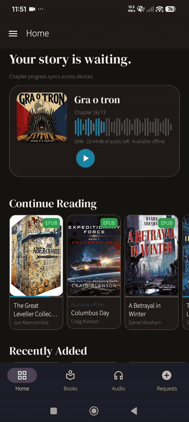
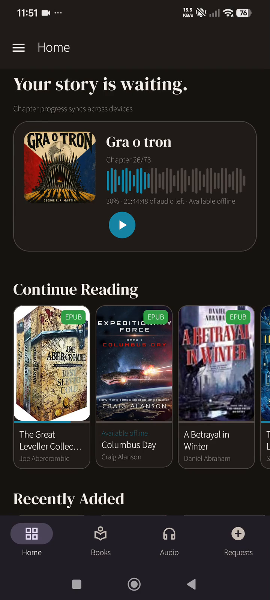
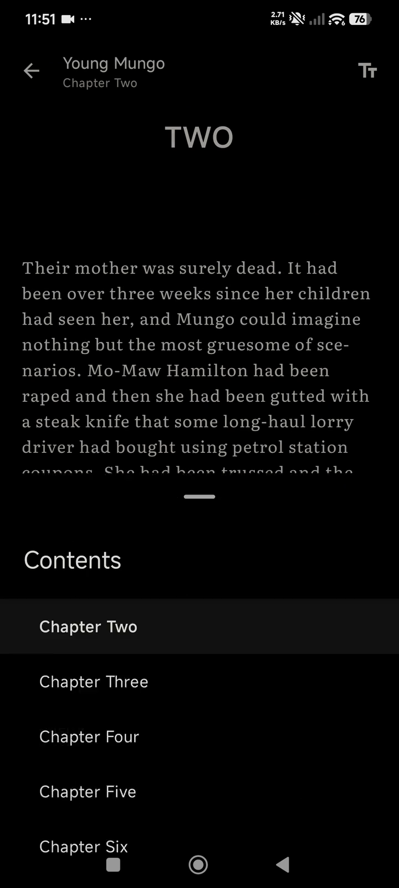
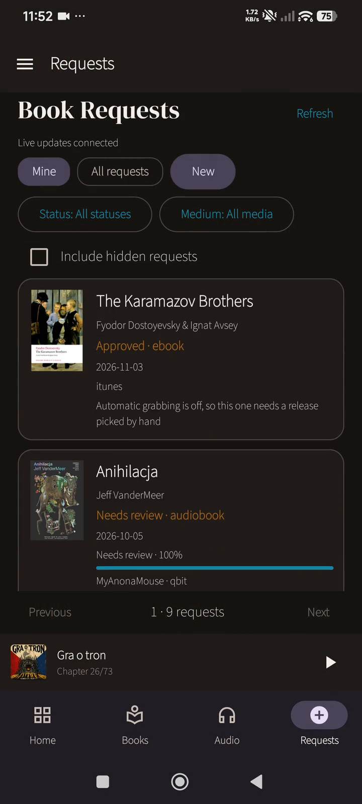
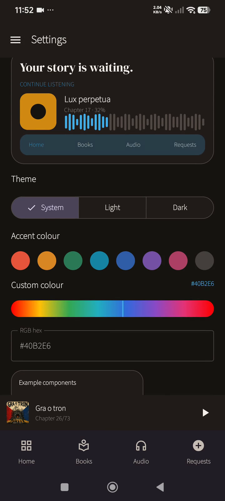

# BookOrbit Android — Product & AI Workflow Showcase

This is a recruiter-friendly showcase of my work on a personal Android client for the self-hosted
[BookOrbit](https://github.com/bookorbit/bookorbit) platform.

The full development repository remains private. This repository focuses on the product, the
problems I worked through, how I used AI-assisted development, and how results were verified.

The application began as a fork of
[`deranjer/bookorbit-android`](https://github.com/deranjer/bookorbit-android). It is not an app I
created from scratch and I do not present it as commercial Android-development experience.

The fork is no longer under active feature development. It became comfortable enough for my own
everyday use, while the upstream BookOrbit project moved toward official mobile clients, including
an iOS application and a planned Android application.

## Demo

1 minute 50 second walkthrough recorded on a physical Android phone
([higher-quality MP4](demo/bookorbit-demo.mp4)).

The recording was made from the app running on my phone on 6 November 2026. It shows:

- the Home dashboard and cached library;
- book details and an EPUB opened through Readium;
- reader themes, fonts and typography controls;
- Books and Audio browsing;
- audiobook playback, chapter navigation and playback controls;
- downloaded/offline status;
- the server-backed Request a Book form;
- library-management navigation;
- application appearance and accent-colour personalization.

It is a walkthrough, not proof that every feature or edge case works in every environment. The
recording intentionally uses my personal installation rather than a fake mock-up.

| Home | EPUB reader | Audiobook player |
| --- | --- | --- |
|  |  |  |

| Request a Book | Appearance settings |
| --- | --- |
|  |  |

## What is BookOrbit Android?

BookOrbit Android is a native Android client for a self-hosted BookOrbit server. My version kept the
existing Android foundation and expanded it to support the current BookOrbit server APIs and the
workflows I actually use.

The main application technologies include Kotlin, Jetpack Compose, Room, WorkManager, Retrofit,
OkHttp, Media3 and Readium.

## What I worked on

### Audiobooks

A major part of the project involved bringing the Android application in line with BookOrbit's
current audiobook APIs. The resulting client supports authenticated streaming, multipart books,
chapter navigation, playback-state synchronization, playback speed, sleep timer, bookmarks,
downloads, offline playback and a persistent mini-player.

This work crossed several connected layers:

**server API → authentication → media assets → player state → local persistence → interface**

### Offline-first library

The application stores useful library data in Room so a cold start without network access does not
turn the app into an empty shell. Cached areas include library browsing, book details, authors,
series, collections and dashboard content. Mutable state is scoped to the correct server and
account.

### EPUB reading

The EPUB path uses Readium and supports local resume, typography controls, bundled reader fonts,
pinch-to-resize text and offline reading. Exact Readium locator state remains local, while server
synchronization uses the progress representation BookOrbit actually supports. The separate PDF path
was deliberately left independent.

### Requests and management

The client also exposes selected BookOrbit server workflows such as book requests, metadata
management, collections, status changes and library actions. Provider search, indexers, ranking and
fulfilment remain server-side rather than being duplicated in Android.

## My involvement and AI's involvement

This project was heavily AI-assisted. I used Claude / Claude Code and OpenAI Codex to investigate
the existing codebase, implement changes, create tests, run builds, diagnose regressions and write
technical documentation.

My role was primarily to:

- define desired product behaviour and scope boundaries;
- describe failures with screenshots and reproducible examples;
- decide which workflows mattered for real use;
- provide server/API context;
- use builds on a physical phone;
- reject incomplete or misleading results;
- require evidence before accepting fixes;
- decide when continued development no longer justified the maintenance cost.

I do not claim that I manually authored every line of Kotlin. See
[How I used AI](docs/ai-workflow.md) for a more detailed and honest division of work.

## Selected case studies

- [Audiobook API migration](case-studies/audiobook-api-migration.md) — updating an interconnected
  streaming, progress, download and offline workflow rather than replacing one endpoint.
- [Offline state and recovery](case-studies/offline-state.md) — separating cached information,
  pending user intent and server/account ownership.
- [Readium reader integration](case-studies/reader-integration.md) — keeping exact local reader state
  distinct from the server's simpler progress representation.

## Why I built this

I use BookOrbit personally and wanted the Android experience to fit how I actually use the system:

- listening to audiobooks;
- using the library away from home;
- reading EPUBs comfortably;
- managing requests and metadata from a phone;
- preserving state reliably.

The project became a practical way to learn how a real application behaves across multiple layers,
not merely a collection of isolated coding exercises.

## Relevance to support and implementation work

The most transferable parts of this project are not tied specifically to Android programming:

- turning vague symptoms into repeatable steps;
- distinguishing server, network, persistence and UI failures;
- documenting expected behaviour and known limitations;
- testing the original user workflow instead of accepting a compile as proof;
- using AI tools productively while checking their output;
- explaining technical behaviour in plain language;
- knowing when to stop investing in a parallel solution.

My professional background is primarily in customer operations. This project helped me develop the
technical side of the same support-oriented problem-solving approach.

## Verification

The latest recorded full debug baseline passed 252 JVM unit tests, Android `lintFullDebug` and
`assembleFullDebug`. Selected reader behaviour was also checked on a physical Android device.

Those results are historical development evidence, not a claim of exhaustive qualification across
all Android devices and versions. The app is also still used as my personal everyday BookOrbit
client. See the full [verification record](docs/verification.md).

## Current status and limitations

**Feature-complete for my personal use; no longer under active feature development.**

- This is a personal client for one self-hosted setup, not an official BookOrbit product.
- It was never commercially launched or distributed as a supported application.
- I relied on AI for implementation and do not claim independent professional Android-development
  experience.
- Some verification is historical and was not repeated solely for this showcase.
- Everyday use is valuable evidence, but it is not a substitute for a formal device test matrix.
- Serious compatibility regressions affecting my own use may still justify a maintenance fix, but
  substantial new feature work is not planned.

## Repository contents

- [`demo/bookorbit-demo.gif`](demo/bookorbit-demo.gif) — inline GitHub-compatible preview
- [`demo/bookorbit-demo.mp4`](demo/bookorbit-demo.mp4) — higher-quality phone-recorded walkthrough
- [`screenshots/`](screenshots/) — still frames extracted from the same recording
- [`case-studies/`](case-studies/) — three focused technical stories
- [`docs/ai-workflow.md`](docs/ai-workflow.md) — how decisions, AI generation and verification were divided
- [`docs/verification.md`](docs/verification.md) — evidence and explicit non-claims
- [`ATTRIBUTION.md`](ATTRIBUTION.md) — upstream and licensing information
- [`LICENSES/AGPL-3.0.txt`](LICENSES/AGPL-3.0.txt) — upstream application licence

